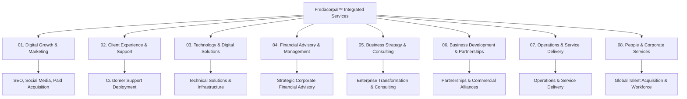
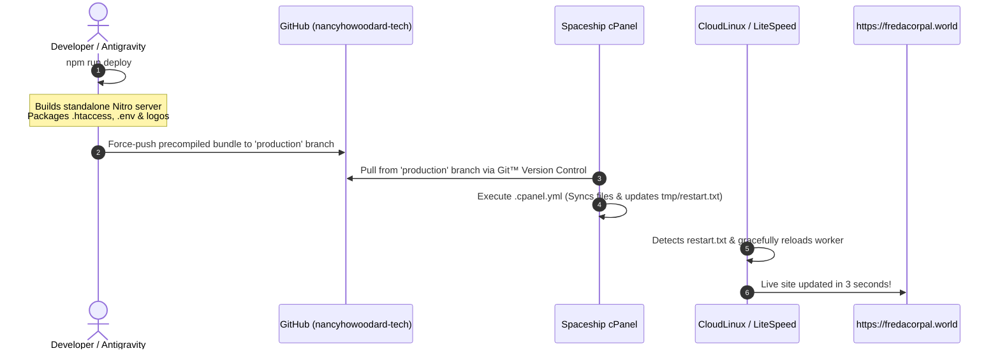

# Fredacorpal™ Integrated Services

<div align="center">


### **"Connecting Talents, Building the Future."**

[](https://fredacorpal.world)
[](https://tanstack.com/start)
[](https://www.typescriptlang.org/)
[](https://tailwindcss.com/)
[](https://nodejs.org/)
[](#intellectual-property--privacy)

**[Visit Live Website →](https://fredacorpal.world)**

</div>

---

## 📌 Executive Overview

**Fredacorpal™ Integrated Services** is a modern, high-performance enterprise web application and digital infrastructure platform. Designed with executive authority, deep navy and metallic gold aesthetics, and resilient server-side rendering (SSR), it serves as the global gateway for prospective clients, partners, and high-caliber remote talent.

The platform provides an integrated operational ecosystem:
- **8 Canonical Corporate Departments**: Structured taxonomy spanning strategic consulting, digital marketing, client support, technology solutions, operations, and financial governance.
- **10 Core Integrated Services**: Comprehensive solutions portfolio with dedicated deep-dive briefs, problem statements, methodology timelines, deliverables, and service milestones.
- **72 Open Career Positions**: Dynamic, department-filtered career catalog providing transparent compensation brackets, core competencies, and immediate application routing.
- **40-Point Native Recruitment Intake Wizard**: A multi-step, verified candidate intake portal (`/apply`) with identity authentication, encrypted document uploads, and direct synchronization to Google Drive and Google Sheets.
- **Enterprise AI Support Assistant**: Dual-engine concierge with an instant deterministic corporate knowledge engine and seamless Google Gemini LLM fallback.
- **1-Click Git-Powered cPanel Deployment**: Native automated pipeline building and synchronizing production-ready SSR bundles directly to shared hosting (LiteSpeed / CloudLinux Passenger).

---

## 🏛️ Organizational Architecture & Departments

The enterprise taxonomy organizes all public operations, service lines, and talent pipelines into eight operating divisions:



| Index | Department | Core Focus & Purpose | Active Services | Active Careers |
| :--- | :--- | :--- | :--- | :--- |
| **01** | **Digital Growth & Marketing** | Organic discovery, algorithmic social architectures, audience acquisition, and paid media performance. | [SEO](/services/seo), [Social Media](/services/social-media), [Paid Media](/services/paid-media) | SEO Expert, Social Media Manager, Paid Media Specialist, +7 more |
| **02** | **Client Experience & Support** | Managed multi-channel support, live chat operations, and client success delivery. | [Customer Support Deployment](/services/customer-support) | Customer Care Assistant, Technical Support Specialist, +7 more |
| **03** | **Technology & Digital Solutions** | Scalable web architectures, API middleware, platform automation, Core Web Vitals, and system reliability. | [Technical Solutions](/services/technical-solutions) | Full-Stack Engineer, Web Developer, Automation Specialist, +10 more |
| **04** | **Financial Advisory & Management** | Corporate cash-flow modeling, capital allocation, liquidity risk, and fiduciary governance advisory. *(Non-retail)* | [Strategic Financial Advisory](/services/financial-advisory) | Financial Analyst, Controller, Risk & Compliance Analyst, +6 more |
| **05** | **Business Strategy & Consulting** | Commercial advisory, organizational design, business process re-engineering, and strategic transformation. | [Strategy & Consulting](/services/strategy-consulting) | Strategy Consultant, Business Analyst, BI Specialist, +7 more |
| **06** | **Business Development & Partnerships** | Commercial alliances, enterprise co-delivery agreements, joint ventures, and account stewardship. | [Business Development](/services/business-development) | Partnerships Manager, Account Executive, Sales Strategist, +8 more |
| **07** | **Operations & Service Delivery** | Cross-department workflow execution, quality assurance frameworks, and service-level agreement governance. | [Operations Delivery](/services/operations-delivery) | Operations Manager, QA Specialist, Workforce Coordinator, +9 more |
| **08** | **People & Corporate Services** | Distributed talent acquisition, candidate onboarding governance, and corporate compliance operations. | [Talent Solutions](/services/talent-solutions) | Talent Acquisition Specialist, HR Compliance Specialist, +8 more |

> **Regulatory Disclaimer (Department 04):** Financial Advisory services are limited to corporate financial management, capital planning, and governance modeling. Fredacorpal™ does not provide retail investment advice, individual trading tips, or cryptocurrency speculation.

---

## 🛠️ Technology Stack

| Layer | Technologies | Purpose |
| :--- | :--- | :--- |
| **Full-Stack Framework** | [TanStack Start](https://tanstack.com/start) + [React 19](https://react.dev/) | Type-safe SSR, server functions, streaming hydration, and Nitro engine. |
| **Routing** | [TanStack Router](https://tanstack.com/router) | 100% type-safe file-based client/server routing with code splitting. |
| **Styling & UI** | [Tailwind CSS v4](https://tailwindcss.com/), [Radix UI](https://www.radix-ui.com/), [Lucide React](https://lucide.dev/) | Enterprise dark/light luxury theme, accessible components, micro-animations. |
| **Data & State** | [TanStack Query](https://tanstack.com/query), [React Hook Form](https://react-hook-form.com/), [Zod](https://zod.dev/) | Reactive asynchronous queries, strict schema validation, form state control. |
| **AI Integration** | [Vercel AI SDK](https://sdk.vercel.ai/), [Google Gemini](https://ai.google.dev/) | Hybrid conversational concierge with deterministic knowledge base fallback. |
| **Storage & Backend** | [Supabase](https://supabase.com/), [Google Drive & Sheets API](https://developers.google.com/apps-script) | Candidate metadata persistence, secure resume & ID document vaulting. |
| **Server & Hosting** | [Nitro Engine](https://nitro.unjs.io/), [CloudLinux Passenger](https://www.phusionpassenger.com/) | Standalone Node.js server optimized for Spaceship / cPanel LiteSpeed hosting. |

---

## 📂 Project Structure

```text
fredacorpal-nexus/
├── .output/                     # Nitro production build artifacts
│   ├── public/                  # Compiled client bundles & static assets
│   └── server/                  # Compiled Node.js SSR server worker
├── deploy-cpanel/               # Staging directory for automated cPanel releases
├── public/                      # Static public web assets
│   ├── apple-touch-icon.png     # iOS touch icon (180x180)
│   ├── favicon.svg              # Self-contained Base64-embedded vector favicon
│   ├── favicon.png              # High-DPI raster favicon fallback
│   ├── fredlogo.svg             # Official self-contained Base64 vector logo
│   ├── fredlogo.png             # Master 512x512 logo artwork
│   ├── robots.txt               # Search engine crawl directives
│   └── sitemap.xml              # Canonical XML sitemap for SEO indexing
├── scripts/                     # Automation & deployment toolchain
│   ├── deploy-git.mjs           # 1-Click push-to-production Git deployment
│   ├── generate-assets.mjs      # SVG base64 vector & raster asset compiler
│   ├── google-apps-script.js    # Google Apps Script webhook integration
│   └── package-cpanel.mjs       # Production bundle packager with .htaccess & env
├── src/                         # Application source code
│   ├── components/              # Reusable UI component architecture
│   │   ├── Button.tsx           # Luxury styled polymorphic CTA buttons
│   │   ├── Cards.tsx            # ServiceCard, JobCard, PartnerCard components
│   │   ├── CareerDetail.tsx     # Full-page job requisition template
│   │   ├── ChatBot.tsx          # Interactive AI support concierge widget
│   │   ├── Footer.tsx           # Global footer with 8-department directory
│   │   ├── Navbar.tsx           # Sticky desktop navbar & mobile drawer
│   │   ├── Primitives.tsx       # Core brand logo, badges, CTA banners
│   │   ├── ServiceDetail.tsx    # Comprehensive service deep-dive template
│   │   └── ThemeToggle.tsx      # Dark/Light enterprise theme switch
│   ├── data/                    # Authoritative corporate data catalogs
│   │   └── site.ts              # 8 Departments, 10 Services, 72 Careers data
│   ├── integrations/            # External backend & database integrations
│   │   └── supabase/            # Client initialization & database types
│   ├── lib/                     # Server functions & business logic
│   │   ├── application.functions.ts # 40-Point candidate submission pipeline
│   │   ├── constants.ts         # Central environment constants & portal URLs
│   │   └── support-bot.ts       # AI knowledge base & conversational engine
│   ├── routes/                  # File-based TanStack routes
│   │   ├── __root.tsx           # Root document layout with meta & theme
│   │   ├── index.tsx            # Homepage with hero, services, metrics & FAQ
│   │   ├── about.tsx            # Corporate mission, values & executive story
│   │   ├── apply.tsx            # 40-Point recruitment application wizard
│   │   ├── careers.index.tsx    # 72-role career directory with department filters
│   │   ├── contact.tsx          # Enterprise client inquiry intake
│   │   ├── departments.tsx      # Interactive 8-department interactive directory
│   │   ├── industries.tsx       # Industry specialization briefs
│   │   ├── partnerships.tsx     # Strategic commercial alliance agreements
│   │   ├── pricing.tsx          # Transparent service retainer tiers
│   │   ├── services.index.tsx   # Integrated 10-service portfolio directory
│   │   └── api/support-chat.ts  # Concierge API handler endpoint
│   ├── start.ts                 # TanStack Start application entrypoint
│   └── styles.css               # Global theme tokens, typography & CSS variables
├── .cpanel.yml                  # cPanel continuous deployment task hook
├── .env                         # Production environment variables (git-ignored)
├── .htaccess                    # LiteSpeed / Apache proxy-aware HTTPS & HSTS
├── app.js                       # CloudLinux Passenger startup entrypoint
├── package.json                 # Project dependencies & build commands
└── vite.config.ts               # Vite & Nitro compilation configuration
```

---

## 🚀 Quickstart & Local Development

### Prerequisites
- **Node.js**: v20.x or v22.x LTS
- **Package Manager**: `npm` (v10+) or `bun`

### Installation & Setup

1. **Clone the repository**:
   ```bash
   git clone https://github.com/nancyhowoodard-tech/fredacorpal.git
   cd fredacorpal
   ```

2. **Install dependencies**:
   ```bash
   npm install
   ```

3. **Configure Environment Variables**:
   Create a local `.env` file in the root directory:
   ```env
   # Core Application URL
   VITE_APP_URL="http://localhost:8080"
   
   # Public Communications
   CONTACT_EMAIL="admin@fredacorpal.world"
   RECRUITMENT_EMAIL="admin@fredacorpal.world"
   
   # Decoupled Staff Portal
   VITE_PORTAL_URL="https://portal.fredacorpal.com"
   
   # Recruitment Webhook (Google Apps Script)
   APPLICATIONS_WEBHOOK_URL="https://script.google.com/macros/s/AKfycbzwf_8bP6-T19lbhr8darpKO7oVAm9vosse0QY7j1odwx_yVsdZEHikXWoF3dIUrjJ5kg/exec"
   
   # Optional: Google Gemini AI API Key for live dynamic reasoning
   GOOGLE_GENERATIVE_AI_API_KEY=""
   ```

4. **Launch development server**:
   ```bash
   npm run dev
   ```
   Open **`http://localhost:8080`** in your browser.

---

## 🚢 Deployment Architecture (Spaceship / cPanel)

The platform features an automated, zero-downtime deployment pipeline designed for **Spaceship Shared Hosting** powered by **cPanel** and **CloudLinux Passenger**.



### 1-Click Deployment Command
Whenever you or Antigravity make updates, simply run:
```bash
npm run deploy
```
*(or run `npm run deploy:cpanel`)*

This command automatically:
1. Optimizes vector graphics, embeds self-contained SVGs, and builds the Node.js Nitro server bundle.
2. Stages `app.js`, `.htaccess` (with proxy-aware HTTPS rules & HSTS), `.env`, and `tmp/restart.txt`.
3. Pushes the release directly to the **`production`** branch on GitHub.
4. Leaves your development `main` branch clean and undisturbed.

### Pulling in cPanel
1. Open **cPanel** $\rightarrow$ **Git™ Version Control** $\rightarrow$ Click **Manage** next to `fredacorpal`.
2. Go to the **Pull or Deploy** tab.
3. Click **"Update from Remote"** followed by **"Deploy HEAD Commit"**.
4. The site updates instantly with zero downtime.

---

## 🔒 Security, Privacy & Compliance Controls

- **Strict Identity Authentication Protocol**: The 40-point candidate intake process (`/apply`) collects mandatory identity verification data (SSN card, Driver's License, references) in compliance with US remote workforce onboarding standards.
- **Data Boundary & Decoupling**: All internal employee notifications, administrative Google Sheets, and candidate document vaults are managed on secure, private backend channels (`nancyhowoodard@gmail.com`). This address is **never exposed** in client-facing code, network payloads, or public email headers.
- **Public Fiduciary Contact**: All public client communications, sales inquiries, and candidate support are routed exclusively through:
  ```text
  admin@fredacorpal.world
  ```
- **Enterprise Transport Security**: Enforced via root `.htaccess` with 301 HTTPS redirects, HTTP Strict Transport Security (`max-age=31536000`), `X-Frame-Options: SAMEORIGIN`, and `X-Content-Type-Options: nosniff`.

---

## 📜 Intellectual Property & Privacy

Copyright © 2026 **Fredacorpal™ Integrated Services**. All rights reserved.

All proprietary trademarks, service marks, organizational taxonomies, visual branding, logos, and custom codebase architectures belong exclusively to Fredacorpal™ Integrated Services. Unauthorized reproduction, distribution, or public deployment of this proprietary platform is strictly prohibited.
